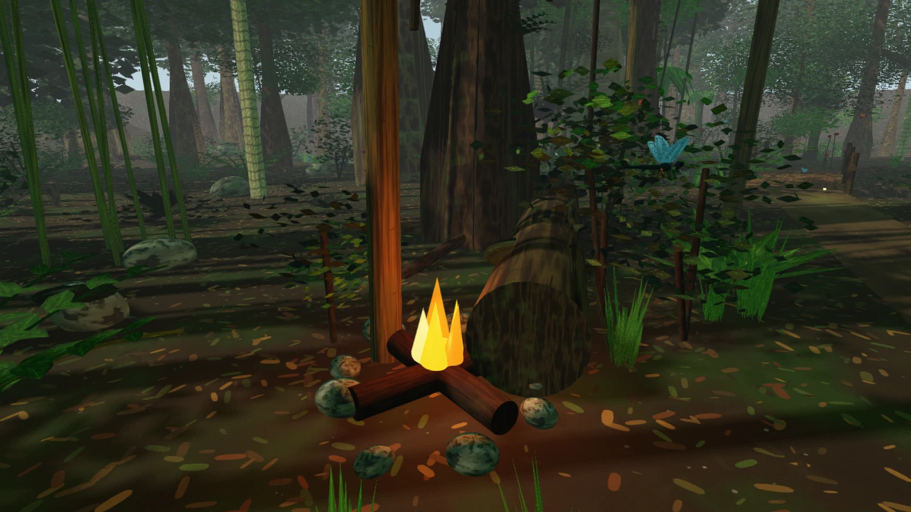

# Lotus

Lotus is a compact C++ game engine for building living worlds. It pairs an ECS
scene model with a normal-mapped Vulkan renderer, Jolt physics, region
streaming, Lua scripting, and an in-engine editor.

## Features

- **Scenes** — EnTT-backed entities, transform hierarchy, persistent GUIDs,
  versioned JSON, prefabs, additive loading, and region streaming.
- **Rendering** — instanced mesh rendering, metallic/roughness PBR, normal maps and
  emissive materials, sun shadows, up to eight point lights, SSAO, FXAA, fog, and
  Hi-Z occlusion culling.
- **Simulation** — Jolt rigid bodies, character controllers, raycasts,
  transform animation, and a camera-relative player controller.
- **Scripting** — Lua scripts attached per entity, with atomic hot reload and
  a small entity/transform API.
- **Tooling** — read-only scene editor, console commands, asset registry,
  async scene loading, and headless screenshot/state capture.
- **Optional modules** — networking sessions/transports and an example RPG
  application built on engine components.

## Architecture

| Document | Covers |
|---|---|
| [Overview](docs/architecture/overview.md) | Subsystem boundaries, frame lifecycle, headless path, testing seams |
| [Rendering pipeline](docs/architecture/rendering.md) | CPU visibility, draw batching, GPU passes, lighting, resources |
| [Scenes, assets, and streaming](docs/architecture/scenes-and-assets.md) | ECS model, serialization, prefabs, assets, residency |
| [Runtime services](docs/architecture/runtime-services.md) | Physics, scripting, animation, input, tooling, optional modules |

## Quick start

GLFW and the Vulkan headers are submodules, so a Linux build needs only a C++20
compiler, CMake, and the development packages for GLFW's X11 and Wayland
backends:

```bash
# Debian, Ubuntu
sudo apt install cmake ninja-build build-essential pkg-config \
    libwayland-dev libwayland-bin libxkbcommon-dev \
    libx11-dev libxrandr-dev libxinerama-dev libxcursor-dev libxi-dev \
    libxext-dev

# Fedora
sudo dnf install cmake ninja-build gcc-c++ pkgconf-pkg-config \
    wayland-devel libxkbcommon-devel \
    libX11-devel libXrandr-devel libXinerama-devel libXcursor-devel \
    libXi-devel libXext-devel
```

```bash
git submodule update --init --recursive
cmake -B build -G Ninja
cmake --build build -j"$(nproc)"
cd build && ./bin/lotus
```

Run from `build/` so scenes, assets, and prefabs resolve correctly. The
windowed application accepts `--scene NAME`, `--scene-dir DIR`,
`--assets-dir DIR`, `--width W`, and `--height H`.

Rendering uses Vulkan 1.3 directly (dynamic rendering and synchronization2;
the engine loads the system Vulkan loader itself, so nothing links libvulkan),
so a Vulkan 1.3 device is required; lavapipe (software) is enough for the tests
and headless runs.

Headless runs use the same scene and renderer path:

```bash
cd build && ./bin/lotus --headless --scene SCENE --ticks 600 \
    --screenshot frame.ppm
```

Add `--dump-state state.json` to write the final scene. Use
`--exec "command; command"` to run console commands before the first tick.

## Screenshots


| Bridge over a stream | Campfire and local lighting |
|---|---|
|  |  |

## Tests

```bash
cd build && ./bin/lotus_tests
```

The GPU tests need a Vulkan 1.3 device (lavapipe, from the `mesa-vulkan-drivers`
package, is enough). On a machine without one they skip and say why, while a
device that exists but breaks the renderer still fails them. `ctest` runs the
suite a second time with the drivers hidden to keep that true, and
`LOTUS_REQUIRE_VULKAN=1` turns a missing device into a failure (CI sets it).

GPU occlusion tests:

```bash
./bin/lotus_tests --gtest_filter=OcclusionGpuTest.*
```

Regenerate shaders with `glslangValidator`:

```bash
./shaders/build-shaders.sh
```

## Render benchmark

`lotus_render_bench` renders a fixed, seeded synthetic scene through the
offscreen pipeline one synchronous frame at a time and reports per-phase times
plus a fidelity check against `bench/golden/render_bench.png`.
`./autoresearch.sh` builds and runs it across available Vulkan devices.

```bash
./autoresearch.sh
```

## Environment

| Variable | Effect |
|---|---|
| `LOTUS_NO_UI=1` | Hide the editor UI |
| `LOTUS_MAX_FRAMES=N` | Exit after N frames |
| `LOTUS_WINDOW_PLATFORM=wayland\|x11\|null` | Window system GLFW uses (default: the session's, from `XDG_SESSION_TYPE`, otherwise Wayland then X11); `null` needs no display and cannot present |
| `LOTUS_CONSOLE="cmd; …"` | Run console commands at startup |
| `LOTUS_PRESENT_MODE=mailbox\|immediate` | Vulkan backend: swapchain present mode (default FIFO, also used when the surface lacks the requested mode) |
| `LOTUS_VK_VALIDATION=1\|sync` | Vulkan backend: Khronos validation layer when installed (`sync` adds synchronization validation); messages are printed and counted, and the Vulkan tests assert zero |

## Applications

| Target | Purpose |
|---|---|
| `lotus` | Windowed runtime and editor shell |
| `lotus_rpg` | Example RPG built on engine systems |
| `lotus_render_bench` | Fixed-scene render benchmark |
| `lotus_tests` | Unit and GPU integration tests |

## Docs

Architecture diagrams live under [`docs/architecture/`](docs/architecture/).
Longer design specifications live under [`docs/superpowers/specs/`](docs/superpowers/specs/).
