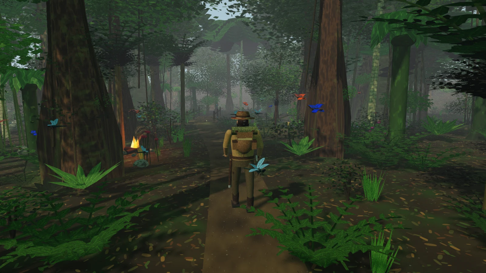
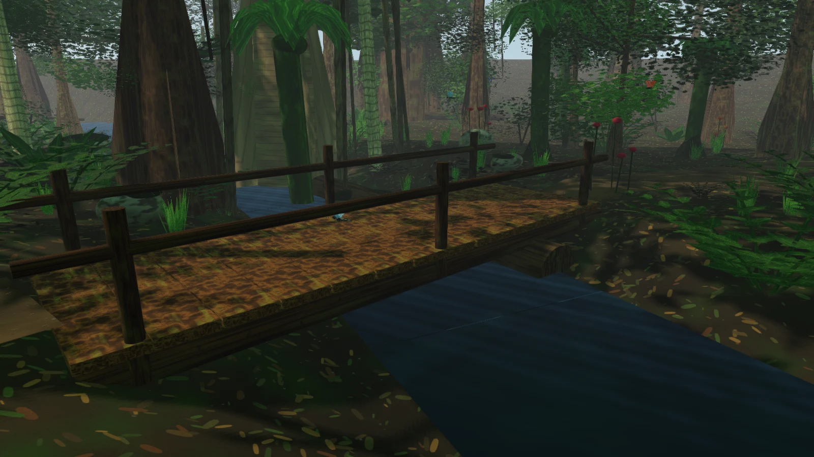

# Lotus

Lotus is a compact C++ game engine for building living worlds. It pairs an ECS
scene model with a normal-mapped SDL GPU renderer, Jolt physics, region
streaming, Lua scripting, and an in-engine editor. The bundled jungle demo puts
the whole stack to work in a dense, walkable scene.



| Plank bridge over the stream | Campfire beneath the canopy |
|---|---|
|  |  |

## Quick start

```bash
git submodule update --init --recursive
cmake -B build -G Ninja
cmake --build build -j"$(nproc)"
cd build && ./bin/lotus
```

Working directory should be `build/` so `scenes/`, `assets/`, and `prefabs/`
resolve correctly.

### Sample hub (`scenes/main.json`)

- **WASD** — move the `player` character (Shift to sprint).
- **F1** — editor (viewport pick uses physics when possible).
- **F2** — console (`help`, `scene.switch`, `scene.load_async`, …).
- **Ctrl+Q** — quit.
- **F2** `game.save` / `game.load` — player pose + active scene name (`saves/game.json`).

Movement is **camera-relative** on the XZ plane (WASD strafe relative to the view).

The gold **bob_prop** sphere plays the `sample_bob` animation clip from
`assets/`. Walk east (~40 m) toward the sign; when the camera enters another
region from `scenes/regions.json`, additive scenes load (one region per frame by
default). Region entries may list `"scenes": ["main"]` to restrict streaming to
one active scene; the demo regions use this so standalone scenes stay clean.

### Jungle scene (`scenes/jungle.json`)

```bash
cd build && ./bin/lotus --headless --scene jungle --ticks 600 \
    --screenshot jungle.ppm
```

Or launch the scene directly:

```bash
cd build && ./bin/lotus --scene jungle
```

(`F2` → `scene.switch jungle` also works from a running instance.) The explorer starts on a
winding trail in a dense, misty jungle: heightfield terrain, a carved stream and
plank footbridge, buttressed hardwoods, palms, banana plants, tree ferns,
strangler figs, bamboo, lianas, epiphytes, moss, layered broad/fine canopy
variants, rocks, flowers, and dappled canopy light.

The avatar is a single atlas-mapped mesh (2K face/clothing/leather/canvas/metal
atlas) with a photo-projected face, painted hair and clothing detail, explorer
kit, and an idle breathing animation. Scripted dragonflies, monarch/morpho butterflies, and bees fly
orbit paths with continuously flapping wings (`scripts/insect_flight.lua`).
**WASD** walks the trail; **F5** toggles first person.

The renderer is a metallic/roughness PBR pipeline with tangent-space normal
maps, emissive materials, up to eight unshadowed point lights, analytic
sky/ground environment specular, hemispheric ambient, SSAO, a warm bounce fill,
fog, and 2048px sun shadows filtered with 5x5 PCF. A campfire, trail lantern,
and fireflies add warm local light under the canopy. It still has no
alpha-cutout leaf cards or image-based lighting, so the scene is a detailed
naturalistic render rather than a photograph; foliage remains geometric and
the human avatar is procedural apart from the projected face texture.

The scene is tuned to stay around 300 MB resident for its 7k entities; foliage
clusters were consolidated and small plants use a compact leaf-tuft mesh so the
engine's per-entity CPU mesh copies stay bounded.

The whole scene is reproducible from source:

```bash
python3 tools/make_jungle.py
```

That regenerates `scenes/jungle.json`, the seamless albedo and normal textures,
the terrain/trail/stream/trunk/foliage/avatar/insect/tree-species GLBs, the two
animation clips, and the scripted insect flight file. It is deterministic
(seed 7), so rerunning it produces the same bytes.

### Tests

```bash
cd build && ./bin/lotus_tests
```

GPU occlusion tests: `./bin/lotus_tests --gtest_filter=OcclusionGpuTest.*`

Regenerate shaders (requires `glslangValidator`):

```bash
./shaders/build-shaders.sh
```

### Rendering geometry

Meshes resolved from a `MeshSource` are uploaded to the GPU once, in local
space, and every entity using one is a single instance record (model matrix and
material) of one indexed, instanced draw per albedo texture and mesh; the shadow
pass replays the same draws. Sprites and hand-built meshes with an empty
`Mesh::source` are written as world-space vertices every frame instead, so use
an empty source for geometry that changes at runtime. Cached meshes that stop
being drawn are released after `GpuRenderer::kMeshIdleFrames` frames.

Within the lit pass, geometry is rasterised into the lower half of the depth
range (`[0, 0.5]`, through the viewport) and the procedural sky is drawn last,
at depth 1.0, over the pixels nothing covered, so its fragment shader never runs
under a surface. Depth is clamped, not clipped, so geometry past the far plane
lands on the top of its range; the halved range keeps that apart from an
untouched pixel. Anything else added to those passes with a depth test has to
use the same range (see `GpuRenderer::draw` and `set_pass_viewport`).

### Render benchmark

`lotus_render_bench` renders a fixed, seeded synthetic scene (~950 entities,
shadows, SSAO, FXAA, sky, fog, Hi-Z occlusion) through the offscreen pipeline
one synchronous frame at a time and reports per-phase times (begin, build,
record, submit, GPU wait) plus a fidelity check of the final frame against
`bench/golden/render_bench.png`. `./autoresearch.sh` builds it and runs it on
the system's Vulkan device, on lavapipe and, when the machine has one, on an
integrated GPU (which can show costs a discrete card hides, such as readback
from write-combined memory); the metrics are documented in its header.

```bash
./autoresearch.sh
```

After an intentional visual change, regenerate the golden (lavapipe only; the
command is in the script header).

### Environment

| Variable | Effect |
|----------|--------|
| `LOTUS_NO_UI=1` | Hide editor UI |
| `LOTUS_MAX_FRAMES=N` | Exit after N frames (automation) |
| `LOTUS_CONSOLE="cmd; …"` | Run console commands at startup |

## Docs

Design specs live under `docs/superpowers/specs/`.

## RPG Game

A full 3D RPG built on the engine: real-time combat, NPCs with dialogue,
inventory, quests, loot, and a demo scene.

```bash
cd build && ./bin/lotus_rpg
```

### Play Mode

- **Play button** in the editor hierarchy panel (or press the button in the
  top-left) to enter play mode.
- **WASD** — move (camera-relative).
- **E** — interact with NPCs, chests, and items.
- **Space** — attack nearest enemy.
- **I** — toggle inventory.
- **Q** — toggle quest log.
- **C** — toggle character stats.
- **Quick slots** — click a consumable in the bar (e.g. Health Potion) to drink
  it (30 HP heal).
- **F1** — return to editor mode.

### Demo Scene (`scenes/rpg_demo.json`)

`scenes/rpg_demo.json` is generated on first run (not committed); fresh clones
create it automatically.

- **Player** — visible green cylinder avatar; starts with iron sword, potions,
  and 100 gold.
- **NPCs** — elder (quest giver), merchant, guard, villager.
- **Enemies** — 3 goblins and 1 orc with AI chase/attack behavior.
- **Quests** — "Goblin Threat" is completable: kill 3 goblins for XP, gold, and
  the Goblin Slayer Blade.
- **Loot** — chests with gold and potions, quest item (ancient amulet).

### RPG Components

All RPG components are serializable and editable in the editor:
`Stats`, `Health`, `Mana`, `Inventory`, `Combat`, `NPC`, `Loot`,
`Interactable`, `AI`, `Dialogue`, `Quest`.

### Mesh Primitives

New builtin meshes: `builtin:cylinder`, `builtin:cone`, `builtin:plane`,
`builtin:pyramid`, `builtin:torus`, `builtin:terrain` (50 m extent, 64×64 grid,
8 m peaks; collidable heightfield) (in addition to `builtin:cube` and
`builtin:sphere`).
