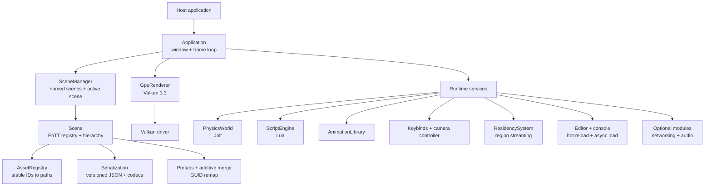
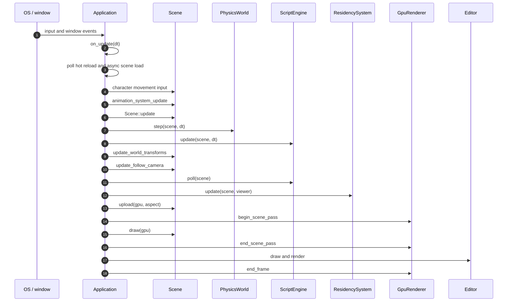

# Architecture overview

Lotus is organized around four boundaries: an application shell, scene data,
a renderer, and runtime services. The boundaries are deliberately narrow so
that scene construction, visibility, serialization, and gameplay systems can be
tested without a window or GPU.

## Design boundaries

- **Application shell** — owns the window, frame loop, input dispatch, editor,
  console, and the active `Scene`. `Application::run` is the windowed path;
  `Application::run_headless` is the test and automation path.
- **Scene data** — an EnTT registry plus hierarchy, persistent GUIDs, component
  codecs, meshes, materials, and scene settings. `Scene` performs CPU-only
  visibility and upload preparation before the renderer records anything.
- **Renderer** — `GpuRenderer` is the backend interface and
  `GpuRendererVulkan` (`src/gpu/vulkan/`) implements it directly on Vulkan 1.3:
  the device, pipelines, textures, buffers, render targets, and pass
  sequencing. It consumes draw batches; it does not know about gameplay or
  serialization.
- **Runtime services** — physics, scripting, animation, input/camera, region
  residency, save games, networking, audio, and tooling. They operate on a
  `Scene` and are driven in a defined order by the application.

## Subsystem map

## Frame lifecycle

The windowed loop polls events, advances simulation, then prepares and submits
one frame. The editor renders after the scene pass so it can present the scene
in a viewport or in the window.

`Scene::update` propagates world transforms and resolves meshes and LOD
geometry. Physics then steps and writes dynamic transforms back; scripts run
after physics. A final world-transform publish runs before the follow camera,
so the renderer sees one consistent transform state for the frame.

## Headless path

`Application::run_headless` uses the same scene and renderer code but skips the
window, editor, audio, and hot reload. It can:

- load a scene,
- run a fixed number of simulation ticks,
- execute console commands,
- dump the final scene JSON,
- render one offscreen frame to a screenshot.

The offscreen renderer follows the same `begin_frame_offscreen` →
`upload` → `begin_scene_pass` → `draw` → `end_scene_pass` → `end_frame`
sequence as the windowed path.

## Testing seams

- `Scene::build_vertices` is pure CPU work: culling, LOD selection, and vertex
  generation can be tested without a GPU.
- `ComponentCodecs` makes serialization extensible without editing a central
  parser.
- `AssetRegistry` separates stable asset IDs from filesystem paths.
- `PhysicsWorld`, `ScriptEngine`, and `ResidencySystem` operate on a `Scene`
  and can be exercised independently.
- GPU tests cover instanced versus immediate geometry and batch grouping.
- GPU tests need a Vulkan 1.3 device (lavapipe is enough) and skip, saying why,
  when there is none; `LOTUS_REQUIRE_VULKAN=1` turns the skip into a failure.

## Related documents

- [Rendering pipeline](rendering.md)
- [Scenes, assets, and streaming](scenes-and-assets.md)
- [Runtime services](runtime-services.md)
