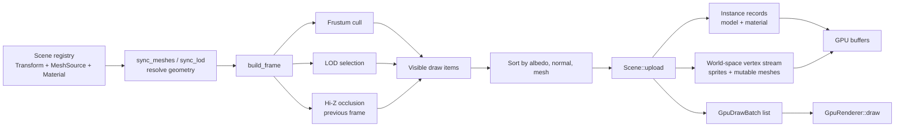
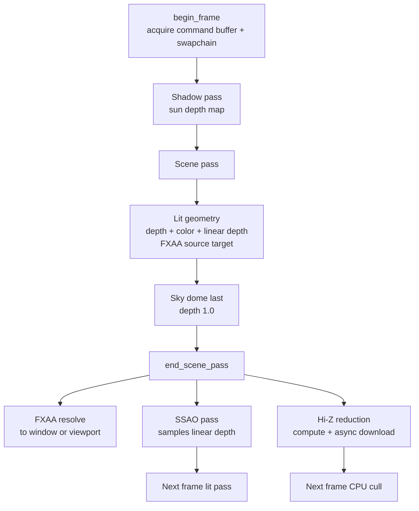

# Rendering pipeline

Rendering is split into a CPU visibility/build stage and a GPU pass sequence.
The CPU stage is independent of SDL and can run headless; the GPU stage consumes
the resulting draw batches.

## CPU stage

- Immutable geometry named by `Mesh::source` is cached on the GPU once and
  drawn as an indexed instanced batch. Every entity using that source becomes
  one instance record (model matrix and material).
- Sprites and hand-built meshes with an empty `Mesh::source` are written to a
  world-space vertex stream each frame. Use this path only for geometry that
  actually changes.
- Draw items are ordered by albedo, normal map, and mesh so equal state stays
  adjacent. `Scene::draw` binds only when one of those keys changes.
- The CPU visibility stage receives the previous frame's depth pyramid. A null
  or empty pyramid disables occlusion culling for that frame.

## GPU frame

The pass sequence in `GpuRenderer` is:

1. **Shadow map** — a depth-only pass from the sun, rendered once per frame.
   The lit shader samples it with a 5×5 PCF kernel plus constant and
   normal-offset bias. Point lights do not cast shadows.
2. **Scene pass** — geometry is drawn with the lit pipeline into a color target,
   a depth target, and a linear-depth color target. The scene pass can be
   redirected to an intermediate target for FXAA.
3. **Sky** — drawn after geometry at depth `1.0`, so its fragment shader only
   runs on pixels not covered by a surface.
4. **FXAA** — when enabled, resolves the intermediate target onto the window or
   editor viewport.
5. **SSAO** — samples the linear-depth target and writes AO for the next frame.
6. **Hi-Z reduction** — a compute pass reduces the linear-depth mip chain; the
   result is downloaded asynchronously and consumed by the next frame's CPU
   cull.

SSAO and Hi-Z both use one frame of latency. That breaks the
render-to-sample-to-render cycle and keeps the loop from blocking on GPU
readback.

## Depth range

Geometry renders into the lower half of the depth range (`[0, 0.5]`), while the
sky renders at `1.0` with a depth test that only fills untouched pixels. Depth is
clamped rather than clipped, so geometry past the far plane lands at the top of
the geometry range and remains distinct from the sky value. Any additional pass
that writes depth to the scene target must use the same convention.

## Lighting and materials

The lit shader is a metallic/roughness Cook-Torrance pipeline with:

- direct sun and shadow-map visibility,
- up to eight unshadowed point lights,
- hemispheric sky/ground ambient and a directional bounce fill,
- tangent-space normal maps,
- metallic/roughness response with a dielectric `F0` of `0.04`,
- emissive materials,
- analytic environment specular,
- SSAO applied to fill light only,
- linear-space fog and ACES tone mapping.

Materials store albedo, roughness, metallic, emissive, and optional albedo and
normal-map asset keys. A missing normal-map binding uses a flat-normal sentinel,
which takes the unperturbed geometric-normal path.

## Render targets and resources

| Resource | Purpose |
|---|---|
| Swapchain or offscreen color | Final window/video output |
| FXAA source color | Intermediate scene target when FXAA is enabled |
| Depth texture | Scene depth test; shadow-map depth uses a separate target |
| Linear-depth `R32F` target | Mip 0 of the Hi-Z chain; SSAO source |
| Hi-Z texture | Reduced depth chain, asynchronously read back |
| SSAO texture | Previous pass AO, sampled by the next lit pass |
| Shadow map | Sun depth, sampled by the lit pass |
| Instance/vertex/UV buffers | Scene geometry streams |
| Mesh cache | One indexed GPU mesh per immutable `Mesh::source` |

## Shader stages

| Shader | Stage | Role |
|---|---|---|
| `lit.vert` / `lit.frag` | Graphics | Instanced/immediate geometry, PBR, shadows, lights, fog |
| `shadow.vert` / `shadow.frag` | Graphics | Sun depth-only pass |
| `sky.vert` / `sky.frag` | Graphics | Procedural sky at depth `1.0` |
| `ssao.vert` / `ssao.frag` | Graphics | Screen-space ambient occlusion |
| `fxaa.vert` / `fxaa.frag` | Graphics | Post-process antialiasing |
| `depth.comp` | Compute | Hi-Z depth reduction |

## Degradation paths

- Shadow resources unavailable: the lit shader receives `shadow_params.x == 0`
  and renders unshadowed.
- FXAA target unavailable: the scene renders directly to its destination.
- Hi-Z reduction unavailable: the linear-depth target is kept as a single-mip
  stand-in, and occlusion is disabled.
- SSAO unavailable: the lit pass binds a white AO texture, so `AO = 1`.

These paths keep the renderer running rather than failing the frame.

## Related documents

- [Architecture overview](overview.md)
- [Scenes, assets, and streaming](scenes-and-assets.md)
- [Runtime services](runtime-services.md)
