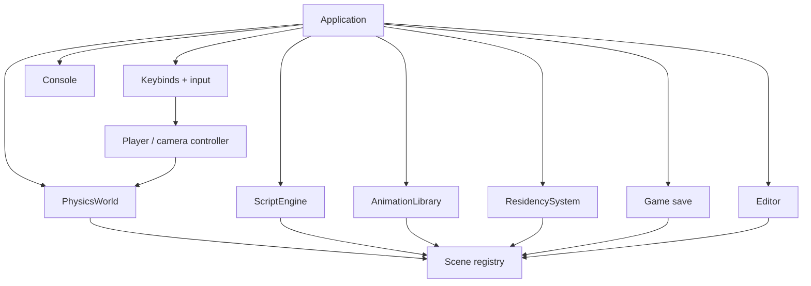
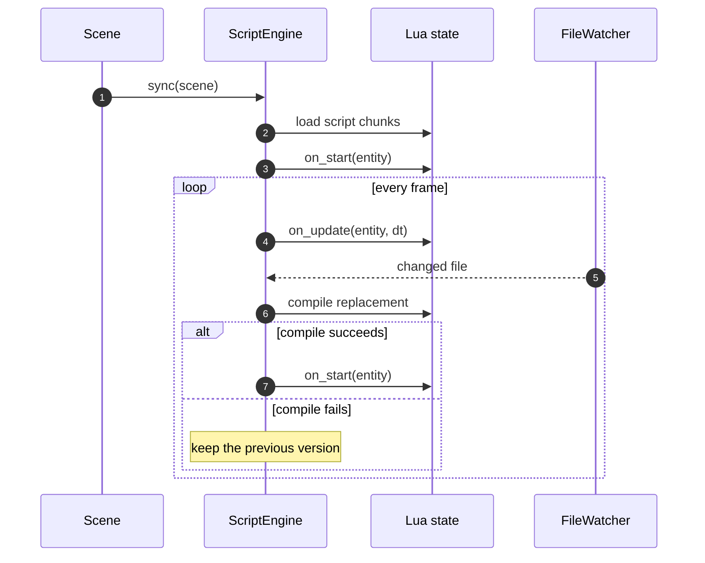

# Runtime services

Runtime services operate on the active `Scene` and are driven by the
application in a fixed order each frame. The order matters: animation writes
transforms before physics, physics writes dynamic transforms back before
scripts, and world matrices are published before the camera and renderer read
them.

## Service map

## Step order

`Application::tick_simulation` runs these steps for the active scene:

| Order | Step | Effect |
|---|---|---|
| 1 | Character movement input | Writes desired velocity from camera-relative input |
| 2 | `animation_system_update` | Samples clips and writes target transforms |
| 3 | `Scene::update` | Propagates world transforms; resolves meshes and LOD |
| 4 | `PhysicsWorld::step` | Steps Jolt, writes dynamic transforms, publishes world matrices |
| 5 | `ScriptEngine::update` | Calls `on_update(entity, dt)` |
| 6 | `update_world_transforms` | Publishes transforms changed by scripts |
| 7 | `update_follow_camera` | Positions the chase or eye camera |
| 8 | `ScriptEngine::poll` | Reloads changed scripts and re-runs `on_start` |
| 9 | `ResidencySystem::update` | Loads/unloads regions around the active camera |

The renderer runs after this sequence: `Scene::upload` builds GPU buffers and
draw batches, then `Scene::draw` records draws inside the renderer's scene pass.

## Physics

`PhysicsWorld` is a single-threaded Jolt backend.

- Static and kinematic bodies are synchronized from `Transform`.
- The world is stepped with a fixed timestep.
- Dynamic results are written back to `Transform`, followed by a world-matrix
  publish.
- `CharacterController` uses a Jolt character virtual; movement input sets its
  desired velocity.
- Colliders include box, sphere, convex mesh, and height field.
- Raycasts return the hit entity, point, normal, and fraction.

Bodies and characters are cleared when the active scene registry is replaced,
because entity handles may be reused by the new scene.

## Scripting

`ScriptEngine` owns one Lua state and runs scripts attached through the
`Script` component.

The Lua API exposes entity lookup, transforms, rotation, color, and name
operations. Script paths can be resolved through `AssetRegistry`, so moving a
script only requires updating the asset table. Load and runtime errors are
reported through an optional log sink; they do not tear down the engine.

## Animation

`AnimationLibrary` stores clips by asset ID. Clips contain transform tracks that
target entities by `SceneGuid`, so animation survives save/load and entity
reordering. `animation_system_update` advances animators and writes position,
rotation, or scale before physics runs.

## Input and camera

- `Keybinds` maps SDL events to named actions and can be loaded from a
  JSON file with defaults backfilled for missing actions.
- The player controller converts camera-relative movement into a
  `CharacterController` velocity.
- The follow camera has a chase view and a first-person eye view; `follow`
  off preserves a fixed authored pose.
- Camera look state is controller-owned and transient, so a scene document
  describes the camera mode rather than a per-frame mouse pose.

## Save games and persistence

`GameSaveData` is a player-centric snapshot separate from scene JSON. It stores
the active scene name, player transform, and resident region list. Scene
persistence handles entity data, prefabs, and settings; game saves handle the
session state needed to resume play.

## Tooling

- The editor is a read-only scene viewer: hierarchy, inspector, viewport,
  stats, assets, keybinds, and console.
- The console is both a log and a command registry. Commands are also usable
  from automation through environment variables and headless execution.
- Scene and script file watchers support atomic hot reload.
- `AsyncSceneLoad` parses documents off the main thread and commits the
  completed scene on the main thread.

## Optional modules

| Module | State |
|---|---|
| Networking | Session, transport, protocol, and byte-buffer types for reliable and unreliable channels |
| Audio | SDL audio device initialization; sample playback is not implemented |
| RPG | A separate example game target built on engine components and systems |

## Related documents

- [Architecture overview](overview.md)
- [Rendering pipeline](rendering.md)
- [Scenes, assets, and streaming](scenes-and-assets.md)
