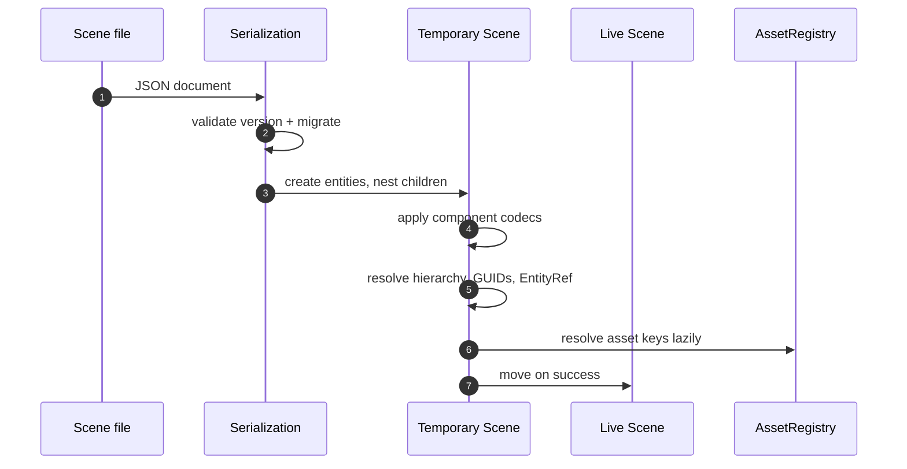
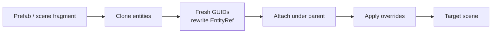
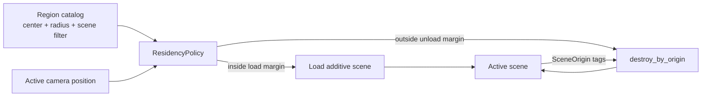
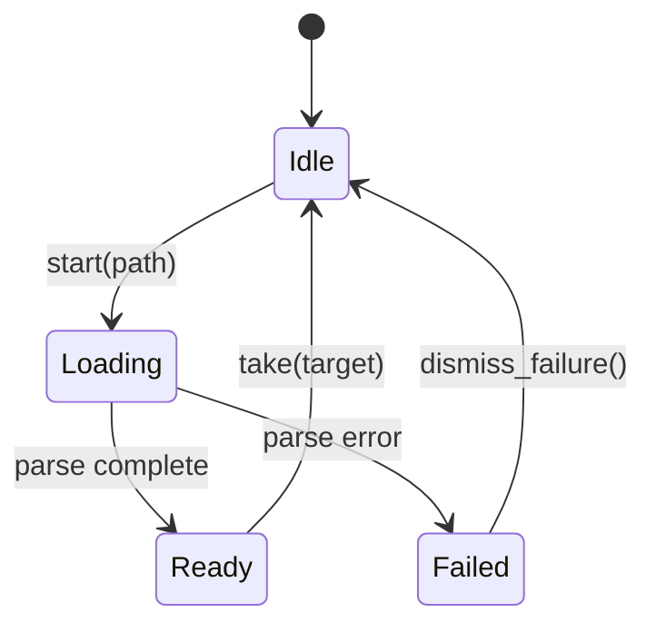

# Scenes, assets, and streaming

A `Scene` is an EnTT registry plus hierarchy metadata, persistent identity,
component codecs, meshes, materials, and optional render settings. The same
scene model is used by the editor, the headless runner, prefabs, and streamed
regions.

## Entity model

| Layer | Responsibility |
|---|---|
| `Registry` | EnTT storage for entities and components |
| `Transform` | Local position/rotation/scale and cached world matrix |
| `Hierarchy` | Parent, first child, and sibling links |
| `Name` | Human-readable label; stored as the entity's `name` field |
| `SceneGuid` | Persistent identity that survives save/load |
| `EntityRef` | Reference by GUID, resolved to a live entity after load |
| `MeshSource` | Geometry path or builtin primitive, optionally with an asset key |
| `Material` | Albedo, roughness, metallic, emissive, albedo/normal asset keys |
| `SceneOrigin` | Which document a merged entity came from |

`Transform`, `Hierarchy`, `Name`, and `SceneGuid` are structural: they are part
of the scene shape and are not removed by ordinary component editing. Derived
data such as `Transform::world` and `EntityRef::resolved` is rebuilt after load
and never serialized.

## Scene load and save

- Documents carry a format version. `migrate_scene_json` upgrades older
  documents before any component is read.
- Parsing builds a temporary scene first. A malformed document leaves the live
  scene untouched.
- `ComponentCodecs` maps component type names to writers and readers. Built-in
  codecs cover the engine components; game code can register additional types
  or override a built-in.
- Unknown components are skipped rather than rejecting the document.
- `entity_to_json` is shared by scene saving and the console's `entity.get`, so
  the two representations cannot drift apart.

## Prefabs and additive merge

Prefabs use the same versioned JSON shape as scenes. Instantiation clones a
fragment and:

1. gives every cloned entity a fresh `SceneGuid`,
2. rewrites internal `EntityRef` values to point at the clones,
3. attaches the clone to the requested parent,
4. applies optional root transform/component overrides.

Additive merge uses the same clone-and-remap path, tags new entities with a
`SceneOrigin`, and leaves existing entities and GUIDs untouched.

## Assets

`AssetRegistry` maps stable IDs to filesystem paths. Scenes store IDs for
meshes and scripts, so moving a file only requires updating the registry.

- `MeshSource` with an `id` resolves through `AssetRegistry`; an empty `id`
  resolves its `path` directly.
- `builtin:` sources generate geometry procedurally (cube, sphere, cylinder,
  cone, plane, pyramid, torus, terrain).
- Other sources load glTF/GLB geometry. Embedded textures are written as PNG
  sidecars when an assets directory is configured.
- Immutable geometry is uploaded once and cached by source; dynamic geometry
  is streamed as world-space vertices each frame.

## Region streaming

`ResidencySystem` applies a `ResidencyPolicy` against the active camera:

- Load and unload use separate margins, which provides hysteresis at region
  boundaries.
- `max_loads_per_frame` bounds how many additive loads run in one update.
- An optional scene-name filter keeps a region catalog scoped to the scenes it
  belongs to.
- When the active scene is replaced, physics bodies and residency state are
  cleared, and the asset registry is rebound before the next tick.

## Async loading and hot reload

`AsyncSceneLoad` parses a document on a worker and produces a complete
`Scene`. The main thread polls a state machine and moves the result in only
when it is ready.

Scene and script file watchers reload changed files. Reloads are atomic: a
failed parse or script compile leaves the live version in place.

## Related documents

- [Architecture overview](overview.md)
- [Rendering pipeline](rendering.md)
- [Runtime services](runtime-services.md)
