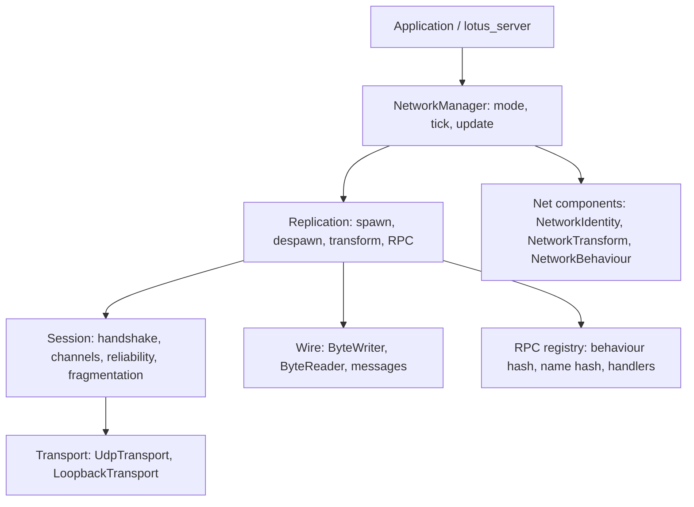

# Networking: transport, replication, and a dedicated server

## Goal

An NGO-shaped networking subsystem: a hand-rolled UDP transport with a
reliability layer, a server-authoritative replication model built on
`NetworkIdentity` / `NetworkTransform` / `NetworkBehaviour`, server and client
RPCs, and a `lotus_server` binary that runs the simulation headless.

Milestone 1 is the deliverable to build now: connect, spawn/despawn, transform
replication with interpolation, ServerRpc/ClientRpc, the dedicated server, and
console commands. Milestones 2-8 are specified here as the agreed contract for
the rest of the NGO surface; each is separately plannable and none of them is a
prerequisite for milestone 1 beyond the seams described below.

Decisions already taken with the user:

| Question | Decision |
|---|---|
| Transport | Hand-rolled UDP plus our own reliability layer. No new dependency. |
| Topology | Dedicated `lotus_server` binary, plus client mode in the normal app. |
| Milestone 1 scope | Core slice (connect, spawn/despawn, transforms) **plus** RPCs. |
| Wire format | Custom binary: varints and quantised transforms. |
| Authority | Server-authoritative by default, per-entity client-authority opt-in. |
| Client world | The server spawns everything; a connecting client starts empty. |

## Repo constraints

Facts about the existing code, each of which shapes the design.

- **No networking dependency exists.** SDL3 is a submodule and has no socket
  API; `dependencies/` holds SDL, entt, glad, glfw, googletest, imgui, jolt,
  json, lua. Only `jolt` was added for a subsystem, via
  `add_subdirectory(dependencies/jolt/Build EXCLUDE_FROM_ALL)`.
- **The engine is single-threaded.** The one worker-thread precedent is
  `AsyncSceneLoad` (parse off-thread, poll, never wait). Networking is
  poll-driven on the main thread and adds no threads.
- **The frame loop is explicit.** `Application::run` orders work as
  `on_update` → `poll_hot_reload` → `poll_async_scene_load` → `animation_system_update`
  → `scene->update` → `physics_.step` → `scripts_.update` → `scripts_.poll` →
  `residency_.update`. Networking slots in as one call after `scripts_.poll`.
- **`Transform::world` is derived** and recomputed by `update_world_transforms`,
  which `PhysicsWorld::step` calls. Anything writing `Transform` must land
  before that, or the renderer and culling read stale matrices.
- **Entity identity already exists.** `SceneGuid` is a `uint64` that survives
  save/load; `Scene::create` assigns one from `next_guid_` (starting at 1, 0 is
  the unassigned sentinel); `Scene::guid_of`, `Scene::find_by_guid`,
  `Scene::assign_guid`, `Scene::resolve_refs` operate on it.
- **Entity-level serialization is file-static.** `write_entity` and
  `entity_from_json` in `src/scene/serialization.cpp` are the canonical
  entity↔JSON pair; `prefab.cpp` calls the same codecs. Nothing public exposes
  a single entity as JSON today.
- **`ComponentCodecs` is the extension point.** `register_component_codec`
  lets any component round-trip through the same reader/writer as the built-ins.
  Registration is process-global and startup-only.
- **Transient fields are never serialized.** `Transform::world` and
  `EntityRef::resolved` are derived and rebuilt on load. There is precedent for
  keeping derived state inside a component.
- **The console is the automation surface.** `LOTUS_CONSOLE="cmd; cmd"`
  executes at startup, `LOTUS_MAX_FRAMES=N` bounds a run, `LOTUS_NO_UI=1`
  hides the editor. This is how the integration smoke test drives a real
  session.
- **New files under `src/` and `test/` are globbed**
  (`GLOB_RECURSE ... CONFIGURE_DEPENDS`), so only a new *executable* needs a
  CMake edit.
- **Tests are gtest, baseline 200 passing.** `build/bin/lotus_tests`.
- **Style:** tabs, C++23, `#include` order is own-header, stdlib, third-party,
  project. `std::optional` is used; `std::span` is not used anywhere today, so
  `std::span<const std::uint8_t>` on the transport and wire interfaces is a new
  but standard-library-only dependency (C++23, `<span>`).

## Architecture

Six layers. Each is testable without the one above it, and no layer reaches
past its neighbour.



`NetworkManager` is the only type `Application` and `lotus_server` talk to.
`Transport` is an interface with two implementations: `LoopbackTransport`
(in-memory, with injectable loss/duplicate/reorder) and `UdpTransport` (POSIX
sockets). The loopback transport is what makes the reliability layer testable
without a socket, which is the whole reason the seam exists.

### Approaches considered for the reliability layer

- **(a) Packet sequence + ack bitfield, per-channel message streams.** Each
  datagram carries a sequence number, the peer's latest acked sequence, and a
  32-bit bitfield of the 32 sequences before it. Reliable messages are resent
  from a send buffer until acked. Unreliable messages are sent once.
  Fragmentation rides the reliable channel.
- **(b) Per-message acknowledgement.** Every reliable message is individually
  acked. Simpler to reason about, but ack traffic scales with message count and
  there is no natural place to hang fragmentation.
- **(c) Stop-and-wait.** One unacked reliable packet at a time. Trivially
  correct, unusable at any real RTT.

**Decision: (a).** It is NGO's model, it is the only one that carries unreliable
and reliable traffic on one socket, and the ack bitfield is a small amount of
code. (b) and (c) would be replaced as soon as latency mattered.

### Approaches considered for the client's world

- **Server spawns everything; the client starts empty** — chosen.
- **Client loads the scene file locally, only `NetworkIdentity` entities
  replicate** — rejected: two sources of truth, and a scene-file mismatch is a
  silent visual bug.

---

# Milestone 1: core slice + RPCs

## 1. Transport

`include/lotus/net/transport.hpp`, `src/net/transport.cpp`.

```cpp
struct Endpoint {
	std::string address;      // "127.0.0.1"
	std::uint16_t port{0};
	bool operator==(const Endpoint& other) const;
};

struct Datagram {
	Endpoint from;
	std::vector<std::uint8_t> bytes;
};

/// Poll-driven datagram transport. No threads: the owner polls once per frame.
class Transport {
public:
	virtual ~Transport() = default;

	/// Sends one datagram. Returns false when the OS rejected it (counted,
	/// never fatal: a UDP send failure is a dropped packet, not an error).
	virtual bool send(const Endpoint& to,
	                  std::span<const std::uint8_t> bytes) = 0;

	/// Returns every datagram available right now. Non-blocking.
	virtual std::vector<Datagram> poll() = 0;

	/// The bound local endpoint, when there is one.
	virtual std::optional<Endpoint> local_endpoint() const = 0;

	/// "udp" or "loopback", for console output.
	virtual const char* name() const = 0;
};
```

`UdpTransport` (`include/lotus/net/udp_transport.hpp`,
`src/net/udp_transport.cpp`):

- POSIX `socket(AF_INET, SOCK_DGRAM)`, `SO_REUSEADDR`, non-blocking
  (`O_NONBLOCK`). IPv4 only in milestone 1; `Endpoint::address` is a dotted
  quad.
- `bind("0.0.0.0", port)` for a server; `bind("0.0.0.0", 0)` for a client so the
  OS assigns the ephemeral port.
- `poll()` loops `recvfrom` until `EWOULDBLOCK`, capped at
  `kMaxDatagramsPerPoll = 256` so one frame cannot be starved by a flood.
- Datagrams larger than `kMtu = 1200` are dropped on receive and counted; they
  can only come from a peer that ignored the MTU.
- `send()` failures and `recvfrom` errors other than `EWOULDBLOCK`/`EINTR`
  increment counters. Nothing throws out of `poll()` or `send()`.
- `set_nonblocking`, `close`, `move`-only. A destructor closes the socket.

`LoopbackTransport` (`include/lotus/net/loopback_transport.hpp`,
`src/net/loopback_transport.cpp`):

```cpp
struct LoopbackPolicy {
	float loss{0.0f};          // probability a datagram is dropped
	float duplicate{0.0f};     // probability a datagram is sent twice
	float reorder{0.0f};       // probability a datagram swaps with the previous
	std::uint32_t seed{1};     // deterministic: the same seed replays exactly
};

/// Creates two endpoints, each of which is the other's peer, so a datagram sent
/// on one is readable from the other after deliver(). unique_ptr because a
/// Transport is polymorphic; ownership transfers to the caller.
struct LoopbackPair {
	std::unique_ptr<LoopbackTransport> a;
	std::unique_ptr<LoopbackTransport> b;
};
LoopbackPair make_loopback_pair(const LoopbackPolicy& policy = {});
```

The peer's inbox is only filled by an explicit `deliver()` call, so a test
controls exactly when bytes cross the wire:

```cpp
class LoopbackTransport final : public Transport {
public:
	/// Moves everything queued on this side into the peer's inbox, applying the
	/// policy. No-op while connected to nothing.
	void deliver();
};
```

Policy application is seeded `std::mt19937`, so loss/reorder tests are
reproducible. Latency is deliberately not modelled in milestone 1; tests that
need a delayed packet call `deliver()` on a later iteration instead.

## 2. Wire format

`include/lotus/net/byte_buffer.hpp`, `src/net/byte_buffer.cpp`.

```cpp
class ByteWriter {
public:
	explicit ByteWriter(std::size_t reserve = 64);

	void u8(std::uint8_t value);
	void u16(std::uint16_t value);
	void u32(std::uint32_t value);
	void u64(std::uint64_t value);
	void i16(std::int16_t value);
	void i32(std::int32_t value);
	void varint(std::uint64_t value);          // LEB128
	void f32(float value);                     // raw bit pattern
	void bytes(std::span<const std::uint8_t> value);
	void string(const std::string& value);     // varint length + bytes

	/// Position quantised to a signed 16-bit grid over ±kPositionRange.
	void position(const glm::vec3& value);
	/// Smallest-three quaternion: 7 bytes.
	void rotation(const glm::quat& value);

	std::vector<std::uint8_t>& data();
	const std::vector<std::uint8_t>& data() const;
	std::size_t size() const;
	void clear();
	void patch_u16(std::size_t offset, std::uint16_t value);
};

class ByteReader {
public:
	explicit ByteReader(std::span<const std::uint8_t> data);

	/// Every reader returns false without writing when the buffer is short.
	bool u8(std::uint8_t& out);
	bool u16(std::uint16_t& out);
	bool u32(std::uint32_t& out);
	bool u64(std::uint64_t& out);
	bool i16(std::int16_t& out);
	bool i32(std::int32_t& out);
	bool varint(std::uint64_t& out);
	bool f32(float& out);
	bool bytes(std::size_t count, std::span<const std::uint8_t>& out);
	bool string(std::string& out);
	bool position(glm::vec3& out);
	bool rotation(glm::quat& out);

	bool ok() const;            // no read has failed
	std::size_t remaining() const;
};
```

Rules:

- Little-endian throughout. Integers are written as their little-endian byte
  sequence explicitly, so the format is independent of host byte order.
- `varint` is LEB128, capped at 10 bytes; a longer run fails the read rather
  than overflowing.
- `string` length is a varint and is checked against the remaining bytes before
  allocating, so a hostile 4 GB length cannot allocate.
- `position` writes `int16` per axis: `x * 32767 / kPositionRange`, with
  `kPositionRange = 512.0f` (world units). Resolution is ~1.6 cm. A component
  further out is clamped, not wrapped.
- `rotation` picks the largest-magnitude quaternion component, stores its index
  and sign in one byte and the other three as `int16` scaled by `1/sqrt(2)`,
  then reconstructs the largest from `sqrt(1 - sum of squares)`. 7 bytes.
- Nothing reads past the end, ever. A truncated or hostile packet leaves the
  reader `!ok()` and the caller drops the message.

## 3. Session: handshake, channels, reliability

`include/lotus/net/protocol.hpp`, `include/lotus/net/session.hpp`,
`src/net/protocol.cpp`, `src/net/session.cpp`.

### Channels

```cpp
enum class Channel : std::uint8_t {
	Unreliable = 0,   // transform snapshots
	Reliable   = 1,   // handshake, spawn, despawn, RPCs, fragments
};
```

Two channels in milestone 1. `ReliableUnordered` is added in milestone 3 for
sync-variable deltas, where an ordered stream would head-of-line block.

### Datagram layout

```
u8      protocol_version   (kProtocolVersion = 1)
u8      flags              bit0: ack-only, no message payload follows
u16     sequence           this datagram's sequence, wrapping
u32     ack                highest sequence received from the peer
u32     ack_bits           mask of the 32 sequences before ack
varint  message_count
        message_count × message frame
```

Message frame:

```
u8      channel
u16     channel_sequence
varint  length
        length × payload bytes
```

- A datagram is at most `kMtu = 1200` bytes of payload.
- `ack` and `ack_bits` are piggybacked on every outgoing datagram, including
  ack-only ones, so acks are never a separate packet type.
- `channel_sequence` is per-channel and only meaningful for reliable channels.
- A datagram whose `protocol_version` differs from ours is dropped and counted
  (milestone 5 turns this into a handshake rejection with a reason).

### Reliability

- The sender keeps a list of unacked reliable messages with the sequence they
  were first sent in. Every `kResendInterval = 100 ms` an unacked message is
  resent, up to `kMaxResends = 10`. Exceeding it marks the connection lost.
- The receiver delivers reliable messages in channel-sequence order, buffering
  out-of-order arrivals. A sequence already delivered is discarded as a
  duplicate.
- Unreliable messages are delivered on arrival, in arrival order, and dropped
  silently if they arrive twice or out of order relative to nothing (no
  ordering guarantee is offered).
- RTT is estimated from `ack` vs. send time with an exponentially weighted
  moving average, used for `net.stats` and for resend tuning.

### Fragmentation

A reliable message larger than `kMaxFragment = 1024` bytes is split:

```
u8      fragment_message_type (0x00)
varint  fragment_id
varint  fragment_index
varint  fragment_count
varint  total_length
        bytes
```

Fragments travel as reliable messages, so a lost fragment is retransmitted.
The receiver reassembles by `fragment_id` and drops an incomplete set after
`kFragmentTimeout = 5 s`. An unreliable message larger than `kMaxFragment` is
dropped and counted: oversized unreliable traffic is a caller bug, not
something to fragment.

### Handshake

```cpp
enum class SessionState { Disconnected, Connecting, Connected, Disconnecting };
```

```
client  -> server  ConnectRequest  { u8 version, u32 client_nonce, string client_name }
server  -> client  ConnectAccept   { u32 client_id, u32 server_nonce, f32 tick_rate }
client  -> server  ConnectComplete { u32 client_nonce }
server  -> client  Disconnect      { u8 reason }
```

- `ConnectRequest` and `ConnectAccept` are reliable; the server resends
  `ConnectAccept` until `ConnectComplete` arrives, which is what makes a lost
  accept recoverable.
- A connection with no traffic for `kConnectionTimeout = 5 s` is dropped by the
  server and reported as disconnected by the client.
- `client_id` is a `uint32` from 1, allocated by the server. 0 means "none".
- Version mismatch, a full server (`kMaxClients = 16`), and a duplicate
  handshake are all answered with `Disconnect{reason}` and a closed session.
- Handshake is unencrypted in milestone 1. Milestone 5 adds a token and a
  MAC; the message shapes above already carry the fields that change.

## 4. Entity identity and components

`include/lotus/net/network_components.hpp`.

```cpp
/// Wire identity of an entity. Assigned by the server, stable for the life of
/// a connection. Distinct from SceneGuid, which is the persistent on-disk
/// identity and survives a reload.
struct NetworkIdentity {
	std::uint32_t network_id{0};
	std::uint32_t owner{0};                    // ClientId; 0 = server
	NetworkAuthority authority{NetworkAuthority::Server};
};

enum class NetworkAuthority : std::uint8_t { Server, Client };

/// Replication settings for a Transform. Send-side fields are serialized;
/// receive-side fields are transient and rebuilt from snapshots.
struct NetworkTransform {
	float send_interval{1.0f / 30.0f};
	float position_epsilon{0.01f};
	float rotation_epsilon{0.005f};

	// Transient, client only. Never serialized.
	float accumulated{0.0f};
	std::vector<TransformSample> samples;
};

struct TransformSample {
	std::uint32_t tick{0};
	glm::vec3 position{0.0f};
	glm::quat rotation{1.0f, 0.0f, 0.0f, 0.0f};
};

/// Marks an entity as carrying RPC handlers registered under \p behaviour_id.
struct NetworkBehaviour {
	std::string behaviour_id;
};
```

Two identities, deliberately:

- `NetworkId` (`uint32`) is the wire identity and is what every message
  references. It is small, cheap to map, and never needs to be globally unique.
- `SceneGuid` (`uint64`) is the persistent identity, already used by
  `EntityRef`, prefabs and origins. Spawn payloads carry it so an `EntityRef`
  inside a replicated component resolves on the client.

`NetworkTransform` follows the existing convention for derived state
(`Transform::world`, `EntityRef::resolved`): transient fields live in the
component and are documented as never serialized. A second component for
receive-side state would be heavier without buying anything.

`NetworkIdentity` is **not** serialized into scene files. It is assigned by
`net.host` at host time and by the spawn path afterwards, so a scene document
never pins a session's ids.

### The GUID collision this creates, and the fix

`Scene::create` assigns `next_guid_++`. A client adopting a spawn payload
creates the entity (taking a fresh GUID) and then applies the `SceneGuid` codec
(overwriting it). `next_guid_` is not advanced past the adopted value, so a
later local create can hand out a GUID the server already used. The fix is one
small addition to `Scene`:

```cpp
/// Adopts \p guid for \p entity and advances the allocator past it, so a later
/// create() cannot hand out a GUID already in use.
void adopt_guid(Entity entity, SceneGuid guid);
```

`adopt_guid` is a `Scene` method, not a network type: it is a correctness fix
for identity, and it is tested on its own.

## 5. Replication

`src/net/replication.cpp`, declared in `network_manager.hpp`.

### Message types

```
0x01 ConnectRequest    0x06 Despawn
0x02 ConnectAccept     0x07 Transform
0x03 ConnectComplete   0x08 ServerRpc
0x04 Disconnect        0x09 ClientRpc
0x05 Spawn             (0x0A, 0x0B reserved for milestone 4 time sync)
```

### Spawn

```
Spawn {
	u32     network_id
	u64     scene_guid
	u32     parent_network_id     (0 = root)
	u8      authority
	u32     owner
	varint  payload_length
	bytes   payload               entity document, see below
}
```

The payload is the entity's own document in the existing scene JSON shape:
`{ "name": ..., "components": { ... } }`, produced by a new public function in
`serialization.hpp`:

```cpp
/// Serializes one entity (no children) in the same shape the scene reader
/// accepts. Network spawn payloads use it so replication and save/load share
/// one schema.
nlohmann::json entity_to_json(const Registry& registry, Entity entity);

/// Creates one entity from a document produced by entity_to_json, applying the
/// document's SceneGuid when it carries one (adopt_guid semantics). Children
/// are not read; replication sends them as their own spawns.
Entity adopt_entity_json(Scene& scene, const nlohmann::json& document,
                         std::vector<std::string>* warnings = nullptr);
```

`entity_to_json` and `adopt_entity_json` are thin wrappers over the existing
file-static `write_entity` / `entity_from_json` plus the existing `SceneGuid`
codec, so there is one implementation. `adopt_entity_json` is the only one
replication uses, because every replicated entity must adopt the server's GUID.
A test asserts the two shapes agree: parsing `to_json_string(scene)` yields the
same component map as `entity_to_json` for the same entity. That is the
anti-drift guard.

JSON in the spawn payload is a deliberate choice: spawns are one-shot, low
rate, and reliability already guarantees delivery. Compactness matters on the
per-tick transform path, not here.

Spawn flow:

- `net.host` walks every entity in the scene and calls
  `server_spawn(scene, entity)`, which allocates a `NetworkId`, emplaces
  `NetworkIdentity`, and queues a `Spawn` per connected client.
- Spawns are sent in ascending `SceneGuid` order, at most
  `kSpawnsPerTick = 32` per tick, so joining a large scene does not burst.
- On `ConnectComplete` the server queues the full spawn set for that client.
- A spawn naming a parent the client has not seen yet is parked in a pending
  list and retried each tick, so parent/child ordering never matters.

Client spawn handling:

1. `adopt_entity_json` creates the entity, its components, and its GUID in one
   step.
2. `NetworkIdentity` is emplaced with the server's values.
3. `NetworkId -> Entity` is recorded in the client's map.
4. `Scene::set_parent` applies the parent once it exists.
5. `Scene::resolve_refs()` runs after each adopted batch, so `EntityRef`
   components inside the payload resolve.

### Despawn

```
Despawn { u32 network_id, u8 reason }
```

Reasons: `Destroyed`, `OwnerLeft`, `SceneUnloaded`. The client destroys the
entity and erases the map entry for it **and its descendants**, because
`Scene::destroy` takes the subtree with it.

### Transform

```
Transform {
	u32     tick
	varint  count
	        count × { u32 network_id, position(6B), rotation(7B) }
}
```

- Unreliable channel. One message per client per tick, not one per entity.
- Only entities whose `Transform` changed by more than
  `position_epsilon` / `rotation_epsilon` since the last send are included.
- The server sends at `tick_rate` (default 30 Hz), independent of the frame
  rate: a tick that does not occur sends nothing.
- The server writes `Transform` into `TransformSample` history for
  client-authoritative entities it relays, so a late joiner's first snapshot is
  not a jump.

Client interpolation:

- Samples are buffered per entity, newest last, capped at
  `kMaxTransformSamples = 16`.
- The client renders at `render_tick = newest_tick - kInterpolationTicks`, with
  `kInterpolationTicks = 3` (100 ms at 30 Hz).
- Position lerps between the two bracketing samples; rotation uses normalised
  lerp (nlerp), which is cheaper than slerp and visually indistinguishable at
  these angular deltas.
- A starved buffer (no bracketing samples) holds the newest sample rather than
  extrapolating, so a hitch does not produce a rubber-band.
- Interpolation writes `Transform` **before** `update_world_transforms`, so the
  renderer sees the interpolated matrix. That is why `NetworkManager::update`
  runs in `on_update` (see the wiring below) rather than after the frame's
  transform propagation: physics and scripts have already run, and the
  interpolated write lands before the frame reads `Transform::world`.

### Client authority

For an entity whose `NetworkIdentity::authority == Client`, the owning client
streams its own `Transform` messages on the unreliable channel. The server:

- accepts the message only from `owner`, and only for an entity that client
  owns;
- validates displacement against `kMaxClientSpeed = 100 m/s` per tick and drops
  a sample that exceeds it (milestone 5 makes this a violation counter);
- relays the accepted sample to the other clients unchanged, tagging it with
  the server's current tick.

### Tick loop

```cpp
void NetworkManager::update(Scene& scene, float dt);
```

- Accumulates `dt` at `tick_rate` (default 30 Hz), capped at
  `kMaxTicksPerUpdate = 4` so a stall cannot spiral, matching the fixed-step
  style `PhysicsWorld` uses.
- Each tick: gather and queue messages; then flush exactly one datagram per
  connected peer containing everything queued.
- In server mode it also drives the simulation only when the owner asks for it.
  `lotus_server` steps the scene itself; the app hosts without stepping.

## 6. RPCs

`include/lotus/net/rpc.hpp`, `src/net/rpc.cpp`.

Without reflection, an RPC is a registered handler plus a hashed name.

```cpp
struct NetworkContext {
	NetworkManager* net{nullptr};
	bool server_side{false};
	std::uint32_t sender{0};      // ClientId of the sender; 0 when from server
	Entity entity{NullEntity};
};

class RpcRegistry {
public:
	using Handler = std::function<void(NetworkContext&, ByteReader&)>;

	/// Registration is startup-only and process-global, matching
	/// register_component_codec. A duplicate or colliding name fails loudly.
	bool add_server_rpc(const std::string& behaviour_id,
	                    const std::string& name, Handler handler,
	                    std::string* error = nullptr);
	bool add_client_rpc(const std::string& behaviour_id,
	                    const std::string& name, Handler handler,
	                    std::string* error = nullptr);

	const Handler* find_server_rpc(std::uint32_t behaviour_hash,
	                              std::uint32_t name_hash) const;
	const Handler* find_client_rpc(std::uint32_t behaviour_hash,
	                              std::uint32_t name_hash) const;

	std::vector<std::pair<std::string, std::string>> names() const;  // sorted
};
```

- Names are hashed with FNV-1a 32-bit at registration and on send.
- Collisions are detected at registration time against the existing table and
  rejected with an error, so a collision can never reach the wire.
- Call side, from game code or a Lua binding:

```cpp
net.server_rpc(scene, entity, "Pickup", [](ByteWriter& w) { w.u32(item_id); });
net.client_rpc(scene, entity, "PlayEffect", [](ByteWriter& w) { w.string("spark"); });
```

Messages:

```
ServerRpc { u32 network_id, u32 behaviour_hash, u32 rpc_hash, varint len, bytes args }
ClientRpc { u32 network_id, u32 behaviour_hash, u32 rpc_hash, varint len, bytes args }
```

Rules:

- `ServerRpc` is sent client→server and is accepted only when the sending client
  owns the entity (milestone 1) or when milestone 2's ownership rules allow it.
- `ClientRpc` is sent server→client. Milestone 1 broadcasts to every connected
  client; targeted delivery (`SendTo.Owner`, `SendTo.Others`) is milestone 2.
  A client that is not hosting has no handler for an inbound `ClientRpc`, and
  an inbound `ServerRpc` is refused: the two directions never share a code
  path, so a malicious client cannot call a `ServerRpc` handler on itself or
  cause a `ClientRpc` to run on the server.
- The receiver resolves `network_id` to an entity, reads that entity's
  `NetworkBehaviour::behaviour_id`, hashes it, and requires it to equal the
  message's `behaviour_hash`. An RPC claiming a behaviour the entity does not
  carry is dropped and counted: the entity's own state is the authority, not the
  packet.
- An unknown RPC logs once per `(behaviour_hash, rpc_hash)` pair and drops.
  Nothing throws on a bad packet.
- Handlers run during `NetworkManager::update`, which the application calls
  from `on_update`; `update_world_transforms` then runs inside the frame's
  `scene->update`, so an RPC that mutates a `Transform` is picked up by the
  same frame's propagation.

## 7. NetworkManager and application wiring

`include/lotus/net/network_manager.hpp`, `src/net/network_manager.cpp`.

```cpp
class NetworkManager {
public:
	NetworkManager();
	~NetworkManager();

	/// Replaces the transport. Tests inject a loopback pair; the app uses UDP.
	void set_transport(std::unique_ptr<Transport> transport);
	Transport* transport();

	// --- server -----------------------------------------------------------
	bool host(std::uint16_t port, std::string* error = nullptr);
	void stop_hosting();
	bool hosting() const;
	std::size_t client_count() const;

	/// Assigns a NetworkId and queues a spawn to every client. Returns 0 when
	/// not hosting.
	std::uint32_t server_spawn(Scene& scene, Entity entity,
	                           NetworkAuthority authority = NetworkAuthority::Server);
	/// Queues a despawn and destroys the entity on the server.
	void server_despawn(Scene& scene, Entity entity);

	// --- client -----------------------------------------------------------
	bool connect(const std::string& host, std::uint16_t port,
	             std::string* error = nullptr);
	void disconnect();
	SessionState state() const;
	std::uint32_t local_client_id() const;
	const std::string& connect_status() const;

	// --- both -------------------------------------------------------------
	/// Polls the transport, advances the session, applies inbound messages,
	/// runs a server tick when due, and flushes queued messages.
	void update(Scene& scene, float dt);

	void set_tick_rate(float hz);
	float tick_rate() const;

	RpcRegistry& rpcs();
	void server_rpc(Scene&, Entity, std::string_view name, const RpcWriter& args);
	void client_rpc(Scene&, Entity, std::string_view name, const RpcWriter& args);

	const NetworkStats& stats() const;
	/// Client ids and per-client stats, sorted by id. Empty when not hosting.
	std::vector<ClientInfo> clients() const;
};
```

`RpcWriter` is `std::function<void(ByteWriter&)>`.

Application wiring:

- `Application` gains `NetworkManager network_;` and `NetworkManager& net();`.
- `Application::on_update` is called first in the frame loop (before
  `poll_hot_reload`, `poll_async_scene_load`, and the animation/scene/physics
  block), so it is too early for networking. `NetworkManager::update` therefore
  goes in the frame's simulation block, immediately after `scripts_.poll(*scene)`
  and before the renderer reads transforms:

```cpp
if (Scene* scene = scenes_.active()) {
	animation_system_update(*scene, animations_, &assets_, dt);
	scene->update(dt);                 // update_world_transforms
	physics_.step(*scene, dt);         // skipped while networked
	scripts_.update(*scene, dt);
	scripts_.poll(*scene);
	network_.update(*scene, dt);       // NEW: interp + RPCs + server tick
	// ... viewer/residency as today ...
}
```

  An interpolated write to `Transform` at that point is not seen by
  `update_world_transforms` until the *next* frame's `scene->update`, which is a
  one-frame (16 ms) lag. That is acceptable and is what the interpolation delay
  absorbs; the alternative — a second `update_world_transforms` call — is a
  needless traversal.
```

- **Physics is skipped while networked.** When `network_.state() == Connected`
  or the manager is hosting, `physics_.step(*scene, dt)` is not called: the
  server owns simulation, and a client that also simulated would fight the
  interpolated transforms. Client-authority entities are moved by game code in
  milestone 1; client-authority *plus* local physics is a milestone 2 item.
- Switching or loading a scene while connected calls `network_.disconnect()`
  first: replicating a new scene into a live session is not a thing milestone 1
  supports.
- The client adopts a server world by clearing the active scene on
  `ConnectComplete` and then applying the spawn stream.

## 8. `lotus_server`

`src/server/main.cpp`, new CMake target.

- Links `lotus_engine` only. Never constructs a `Window` or a `GpuRenderer`, so
  it runs on a machine with no GPU and in CI.
- Arguments: `--scene <path>` (default `scenes/main.json`), `--port <n>`
  (default 7777), `--tick <hz>` (default 30), `--assets <dir>` (default
  `assets`), `--frames <n>` (default unlimited), `--quiet`.
- Loop: `scene.update(dt)` → `physics_.step(scene, dt)` → `network_.update(scene, dt)`,
  with `dt` clamped to `kMaxFrameTime = 0.25 s` so a debugger break does not
  spiral the accumulator. `scene.update` runs first, so the server always
  simulates from world transforms it produced itself this frame; the network
  layer never feeds the server its own interpolation.
- Honours `LOTUS_CONSOLE` (so automation can drive console commands) and
  `LOTUS_MAX_FRAMES`.
- `SIGINT`/`SIGTERM` set a `volatile std::sig_atomic_t` flag; the loop exits and
  the destructor closes sockets.
- Exits non-zero when the scene fails to load or the port cannot be bound.

## 9. Console commands

Registered by `Application::register_commands`, so the client app gets them.

| Command | Behaviour |
|---|---|
| `net.host <port>` | Binds UDP on `port`, registers every entity in the active scene, starts ticking. |
| `net.connect <host> <port>` | Starts a client session. |
| `net.disconnect` | Closes the session; the local scene is left as it is. |
| `net.status` | Mode, session state, tick rate, client id, client count, peer list. |
| `net.stats` | Counters: packets/bytes sent and received, resends, drops, RTT, loss. |
| `net.rpcs` | Registered RPC names, sorted, server and client. |
| `net.entities` | Replicated entities: network id, owner, authority, and the send counters for each. This is what makes the acceptance test below assertable from the console. |

`lotus_server` registers the same table minus the client-only commands.

## 10. Tests

Unit tests, no sockets:

- `test/net_byte_buffer_test.cpp` — round-trip every writer/reader pair;
  varint boundaries (0, 127, 128, 16383, `UINT32_MAX`, `UINT64_MAX`);
  truncation at every offset leaves the reader `!ok()` and never reads past the
  end; an oversized string length is rejected without allocating.
- `test/net_quantisation_test.cpp` — position round-trips within the grid
  resolution across the range and clamps outside it; rotation round-trips within
  0.5 degrees for random unit quaternions including all four "largest
  component" cases and both signs; a zero quaternion does not produce NaN.
- `test/net_loopback_test.cpp` — datagrams arrive only after `deliver()`;
  a seeded loss policy drops exactly the datagrams the seed predicts; duplicate
  and reorder policies do what they say.
- `test/net_session_test.cpp` — handshake completes; a lost `ConnectAccept` is
  recovered by resend; a version mismatch is rejected with a reason; reliable
  messages arrive in order under reorder; a reliable message survives 30% loss;
  a duplicate reliable message is delivered once; a message larger than
  `kMaxFragment` reassembles; an incomplete fragment set times out; the
  connection times out with no traffic.
- `test/net_replication_test.cpp` — host registers the scene; a client connects
  and receives a spawn for every entity; components and hierarchy arrive
  intact; `EntityRef` inside a payload resolves; a spawned child whose parent
  has not arrived is parked and then adopted; a despawn removes the subtree from
  the client map; transform deltas respect the epsilon; a client-authority
  transform is accepted from the owner, refused from a non-owner, and refused
  when it exceeds the speed limit.
- `test/net_rpc_test.cpp` — a registered ServerRpc runs on the server with the
  sender's id; a ClientRpc reaches every client; an RPC for an entity without
  that behaviour is dropped; an unregistered RPC is dropped without throwing; a
  registration collision is rejected with an error.
- `test/net_udp_test.cpp` — bind, send, receive on `127.0.0.1` with an ephemeral
  port; oversized datagrams are dropped. Skipped with `GTEST_SKIP()` when
  socket creation fails, so a sandbox without sockets does not break the suite.
- `test/net_guid_test.cpp` — `Scene::adopt_guid` sets the GUID and advances the
  allocator, so a later `create()` never reuses an adopted value; adopting a
  lower GUID than the current maximum does not rewind the allocator.

Integration, the real proof:

- Two `NetworkManager`s over a loopback pair: host, connect, assert the client
  scene gains the entity, move the server transform, tick, and assert the client
  converges to the interpolated position.
- A scripted UDP smoke test driving the real binaries:
  `LOTUS_MAX_FRAMES=300 build/bin/lotus_server --scene scenes/main.json --port 7788`
  alongside `LOTUS_CONSOLE="net.connect 127.0.0.1 7788; net.status"` and
  `LOTUS_MAX_FRAMES=120 build/bin/lotus`, asserting the client's `net.status`
  reports `Connected` with a non-zero client id and a spawned entity count.

## 11. Build changes

The one exception to "no CMake edits", exactly as Jolt was.

```cmake
add_executable(lotus_server src/server/main.cpp)
target_link_libraries(lotus_server lotus_engine)
set_target_properties(lotus_server PROPERTIES
    RUNTIME_OUTPUT_DIRECTORY ${CMAKE_BINARY_DIR}/bin)
```

No new dependency, no `find_package`. Linux sockets need no extra library.

## 12. Milestone 1 acceptance

- `cmake --build build -j"$(nproc)"` succeeds with no new warnings.
- `build/bin/lotus_tests` passes with the baseline of 200 plus the new tests.
- `build/bin/lotus_server` starts, binds, and serves; a client connects over
  real UDP, receives the whole scene, and reports `Connected`.
- A moving server entity is observed moving on the client. Asserted from the
  console: `net.entities` on the client reports the entity's network id and a
  transform receive count that keeps increasing.
- An RPC sent by the client runs on the server; an RPC sent by the server runs
  on the client.
- Killing the server makes the client report disconnected within the timeout.

---

# Milestone 2: ownership, authority, and spawn/despawn policy

Contract, to be planned after milestone 1 lands.

- **Ownership transfer.** `NetworkManager::server_set_owner(scene, entity, client_id)`
  sends `OwnerChange{ network_id, new_owner }` reliably. The previous and new
  owners are notified; `NetworkIdentity::owner` updates on every peer.
- **Spawn policy.** `NetworkManager::server_spawn(scene, entity, owner, authority)`
  plus targeted spawn: a client only receives spawns for entities it should see
  (the AoI half is milestone 6; the message shape already allows a per-client
  spawn set).
- **ClientRpc targeting.** `SendTo::Everyone` (milestone 1 behaviour),
  `SendTo::Owner`, `SendTo::Others`, `SendTo::Client(id)`. A `target` byte
  precedes the RPC payload; the server filters, and a client-side filter refuses
  a targeted RPC that is not for it.
- **Client-authority plus physics.** An owning client simulates its own
  entity's physics and streams the result; the server accepts, validates, and
  relays. Requires a per-entity "simulated locally" flag so the client's
  `physics_.step` can be restricted to owned entities instead of skipped
  wholesale.
- **Ownership rules for ServerRpc.** Only the owner may call; the owner may
  also call on entities it does not own when the entity's
  `NetworkAuthority::Server` and the RPC is registered as `RequireOwnership::No`.
- **Graceful disconnect.** `OwnerLeft` despawns the leaver's owned entities (or
  reassigns them to the server), driven by a per-entity `DestroyOnOwnerLeave`
  flag.
- **Reconnect.** A client reconnecting with the same `client_nonce` within
  `kReconnectWindow = 30 s` resumes its `client_id` and ownership instead of
  receiving a fresh world.

Tests: ownership transfer reaches all peers; a non-owner's ServerRpc is
refused; targeted ClientRpc reaches only the target; a disconnecting owner's
entities follow the configured policy; a reconnect within the window keeps the
client id.

# Milestone 3: sync variables and delta compression

- **`NetworkVariable<T>`.** A typed value with an owner, a write permission
  (`Server`, `Owner`, `Everyone`), and a dirty flag. `net.sync_vars(scene, entity)`
  registers an entity's variables. The value's serializer is the entity's
  component codec (`register_component_codec`), so a game type declares the
  variable once and reuses the codec it already registered.
- **Dirty sync.** Once per tick the server collects changed variables and sends
  `SyncVarDelta{ network_id, varint count, count × { varint var_index, bytes value } }`
  on the new `ReliableUnordered` channel: order between different variables is
  irrelevant, and one lost delta must not block the next.
- **Baseline and delta compression.** Each client holds a confirmed baseline of
  replicated state, and the server sends deltas against it. Baselines are
  *not* timestamped: a client acknowledges each applied baseline with
  `BaselineAck{ tick }`, and a baseline with no acknowledgement for
  `kBaselineTimeout = 5 s` (or one the client reports as unknown) forces a full
  snapshot.
- **Interest filtering** by a `NetworkVisibility` component (a radius plus a
  layer mask) so a client is not sent variables it cannot see. The AoI
  machinery is milestone 6; this is the per-entity opt-out.
- **Transform batching** with a shared baseline: transform messages become
  deltas against the last acknowledged tick, which is where the real bandwidth
  win is.

Tests: a sync variable replicates; a delta against a stale baseline triggers a
full snapshot; an unordered channel delivers a later delta after an earlier one
is lost; a variable the client cannot see is never sent.

# Milestone 4: prediction and reconciliation

The largest milestone, and the one that needs engine support.

- **Determinism prerequisite.** Prediction needs the same input to produce the
  same state on both sides. The engine has no fixed-point or lockstep story, so
  this milestone starts with a determinism audit: `PhysicsWorld` substep order,
  Jolt's determinism guarantees with a fixed seed, and a canonical float path.
  If that audit fails, prediction is scoped to a small set of game-code-driven
  entities that do not touch Jolt.
- **Input buffer.** The client records `(tick, input)` and sends
  `InputCommand{ tick, bytes }` reliably. The server buffers, applies inputs in
  tick order, and echoes the last applied tick per client.
- **Reconciliation.** The server sends `StateAck{ tick, position, rotation, velocity }`
  for the client's own entity. The client rewinds to the acked state, replays
  unacknowledged inputs, and smooths the visual error over
  `kReconcileSmoothing = 100 ms` rather than snapping.
- **Rollback on the server** for lag compensation: the server keeps a
  `kHistoryTicks = 32` ring of entity transforms and raycasts against the
  rewound state, so a shot is judged where the target was when the shooter
  fired.
- **Time sync.** The reserved `0x0A`/`0x0B` messages become `TimeSyncPing` /
  `TimeSyncPong`, and the client keeps the lowest-RTT sample of the last 10 to
  estimate the server clock offset.

Tests: a replay of the same inputs from the same state is bit-identical; a
reconciled client converges to the server position within a tolerance; a
rollback raycast hits the rewound position, not the current one.

# Milestone 5: security and hardening

- **Handshake token.** `ConnectRequest` gains a `session_token`; the server
  issues it out of band (a file, a console command, an env var) and rejects a
  mismatch with `Disconnect{Reason::BadToken}`.
- **Per-packet MAC.** A truncated keyed hash (BLAKE2s-128 via a vendored
  reference implementation, or HMAC-SHA256 from OpenSSL if the dependency is
  acceptable) over the datagram header and payload, with the key derived from
  the handshake nonces. Replay is prevented by the existing sequence numbers
  plus a `kReplayWindow = 1024` window.
- **Rate limiting.** Per-client budgets: packets/s, bytes/s, RPCs/s, spawn
  requests/s. Exceeding a budget is a violation counter; `kMaxViolations = 10`
  disconnects.
- **Validation.** Every inbound message is validated against entity ownership,
  behaviour membership, and speed limits before it mutates anything. A rejected
  message increments a counter and never throws.
- **Fuzzing.** A libFuzzer target for `Session::receive_datagram` and the
  message readers, plus a corpus of truncated and mutated packets. This is the
  test that makes the "never reads past the end" claim real.
- **Flood resistance.** Datagram-per-poll cap, fragment-set cap, and a cap on
  pending spawns per client, so a hostile peer cannot allocate unbounded memory.

Tests: a bad token is rejected; a tampered datagram fails its MAC; a replayed
datagram is dropped; a fuzz corpus runs clean under ASan/UBSan; a flood is
capped rather than OOM.

# Milestone 6: content streaming and area of interest

- **Replicated scenes.** `NetworkScene{ name, load_state, client_ready }`: the
  server tells clients which scene to load, and the client loads it locally,
  which is the "client loads the scene file" model applied to *levels* rather
  than entities. Static geometry then comes from the file instead of the wire.
- **Additive content.** Scene content (prefabs, meshes, textures) is addressed
  by `AssetRegistry` key. A client missing a key requests it; the server
  streams the file over the reliable channel in chunks with a hash, and the
  client verifies and registers it. This is what lets a client join with no
  local assets.
- **Area of interest.** A grid or octree over `NetworkVisibility` radii; a
  client receives spawns only for entities inside its interest set, and
  despawns when they leave. Interest changes are rate-limited so a fast-moving
  player does not thrash.
- **Priority and budget.** Per-tick bandwidth budget with a priority function
  (distance, staleness, recent change), so a busy server degrades gracefully
  instead of dropping packets at the socket.
- **Sync-scene loading.** A client's readiness gates the spawn stream, so a
  client is not flooded with entities for a level it has not loaded.

Tests: a client joining a streamed scene loads it and receives spawns; leaving
the interest radius despawns and re-entering respawns; a byte budget is never
exceeded in a tick.

# Milestone 7: matchmaking, lobby, and transport options

- **Lobby.** A lightweight pre-game state on the same connection: players join,
  set ready, pick a team, and the server starts the match. `LobbyState` is a
  replicated sync variable (milestone 3).
- **Server discovery.** LAN broadcast on UDP plus a manually configured address
  list. No central service.
- **Relay and NAT.** Explicitly *out of scope*: it needs a hosted
  infrastructure component, and a spec should not pretend otherwise. A future
  milestone would add a relay client and a rendezvous server as a separate
  deliverable.
- **IPv6.** `Endpoint` grows a family and `UdpTransport` binds `AF_INET6`;
  the wire format does not change.
- **WebSocket/WebRTC transport.** A second `Transport` implementation for a
  browser client. The interface exists for exactly this; it is not built until
  there is a browser client to serve.

Tests: a lobby round-trips through join/ready/start; LAN discovery finds a
server on the loopback interface; IPv6 binds and connects when the host
supports it.

# Milestone 8: observability and tooling

- **Packet capture.** `net.capture <path>` writes a length-prefixed dump of
  every datagram with a timestamp and direction. `net.replay <path>` feeds a
  dump through a `LoopbackTransport`, which turns a production bug into a
  reproducible unit test.
- **Network profiler.** Per-message-type byte and count histograms, a
  per-second bandwidth graph in the editor, and an RTT/loss graph.
- **Editor panels.** A Network panel listing clients (id, address, RTT, loss,
  bytes/s), replicated entities (network id, owner, authority, last send), and
  registered RPCs.
- **Deterministic simulation commands.** `net.simulate loss <p>`,
  `net.simulate duplicate <p>`, `net.simulate reorder <p>`, `net.simulate
  latency <ms>` wired to the loopback transport, so a developer can feel a bad
  network without leaving the app. Latency is added to the loopback transport
  here, behind an injected clock.
- **Overload telemetry.** Warnings when the tick budget is missed, when a
  client's bandwidth budget is exceeded, or when resend counts spike.

Tests: a capture/replay round-trip reproduces the same session state; the
profiler counters match the transport counters.

---

## Explicitly out of scope

Stated so nobody assumes otherwise:

- Voice chat, text chat, and any gameplay-level service.
- Server hosting infrastructure, matchmaking services, or a backend.
- Cheat detection beyond the validation and rate limits in milestone 5.
- Console/platform certification requirements.
- Cross-platform sockets beyond Linux and macOS (Windows would need a
  `winsock2` path in `UdpTransport`; the interface already isolates it).

## Build and verification

- Build: `cd build && cmake --build . -j"$(nproc)"`.
- Tests: `build/bin/lotus_tests`. Baseline is 200 passing; never lower.
- Server smoke: `build/bin/lotus_server --scene scenes/main.json --port 7788`.
- Client smoke: `LOTUS_CONSOLE="net.connect 127.0.0.1 7788; net.status" LOTUS_MAX_FRAMES=120 build/bin/lotus`.
- No CMake edits for new files under `src/` or `test/`. `lotus_server` is the
  one exception, and it needs no new dependency.
